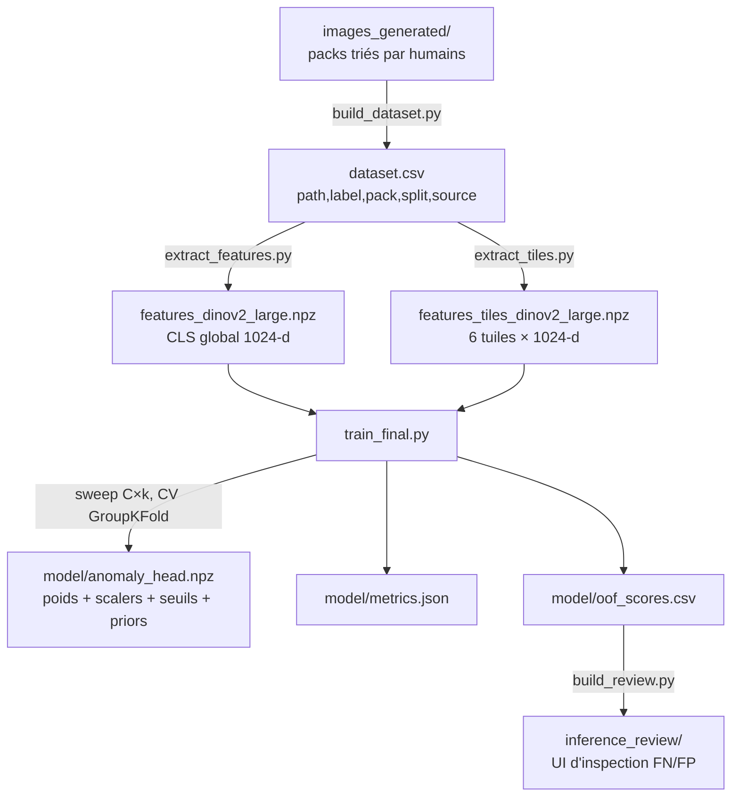
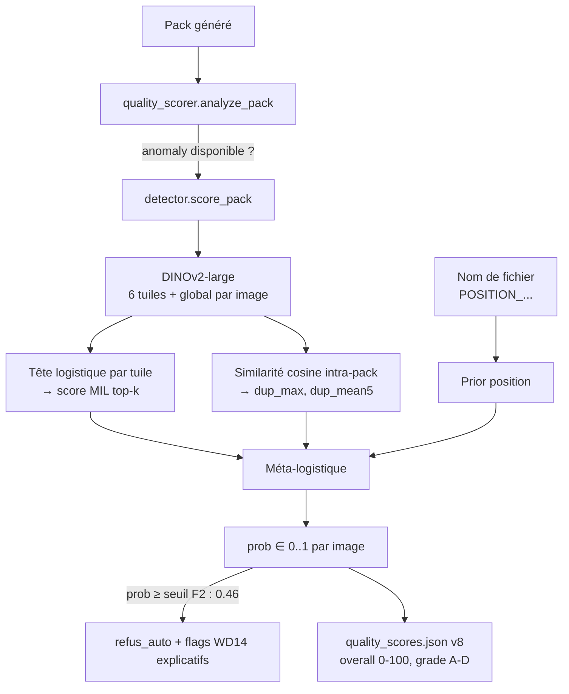

# Détection d'anomalie des packs — Rapport technique d'ingénierie

**Système :** `frontend/anomaly/` — architecture `tile_mil_meta_v5` (déployée)
**Rôle :** prédire, pour chaque image générée d'un pack, la probabilité qu'un
humain la refuse (défaut de génération), afin d'automatiser/assister le tri.
**Performance :** AUROC **0.814**, AP **0.543** (validation croisée par pack) —
contre 0.598 / 0.196 pour l'heuristique CLIP+WD14 qu'il remplace.
**Dernier entraînement :** 2026-08-07 (`model/metrics.json`).

---

## Table des matières

1. [Problème et cadrage](#1-problème-et-cadrage)
2. [Vue d'ensemble du pipeline](#2-vue-densemble-du-pipeline)
3. [Construction du dataset](#3-construction-du-dataset)
4. [Extraction de représentations (DINOv2)](#4-extraction-de-représentations-dinov2)
5. [Étage 1 — Tête logistique par tuile et agrégation MIL](#5-étage-1--tête-logistique-par-tuile-et-agrégation-mil)
6. [Étage 2 — Features de duplication intra-pack](#6-étage-2--features-de-duplication-intra-pack)
7. [Étage 3 — Prior par position (lissage bayésien)](#7-étage-3--prior-par-position-lissage-bayésien)
8. [Étage 4 — Méta-logistique (stacking sans fuite)](#8-étage-4--méta-logistique-stacking-sans-fuite)
9. [Protocole d'évaluation](#9-protocole-dévaluation)
10. [Choix du seuil de décision](#10-choix-du-seuil-de-décision)
11. [Historique des versions et gains mesurés](#11-historique-des-versions-et-gains-mesurés)
12. [Confrontation des idées — pistes testées et rejetées](#12-confrontation-des-idées--pistes-testées-et-rejetées)
13. [Inférence en production](#13-inférence-en-production)
14. [Boucle d'amélioration continue](#14-boucle-damélioration-continue)
15. [Limites et menaces à la validité](#15-limites-et-menaces-à-la-validité)
16. [Annexes](#16-annexes)

---

## 1. Problème et cadrage

### 1.1 Définition du problème

Le studio génère des packs d'images (Stable Diffusion, pipeline
`studio_server.py`). Une fraction des images présente des **défauts de
génération** : membres surnuméraires, mains difformes, anatomies fusionnées,
doublons quasi identiques, rendus incohérents. Historiquement, un humain triait
chaque pack en déplaçant les mauvaises images dans `<pack>/_rejected/`.

Le problème est formulé comme une **classification binaire supervisée** :

$$
f : \text{image } x \;(\text{+ contexte pack}) \longrightarrow \hat{p} = P(\text{refus humain} \mid x) \in [0,1]
$$

Le point clé du cadrage : **la vérité terrain n'est pas « l'image est
défectueuse » mais « un humain l'a refusée »**. C'est un choix délibéré —
le but opérationnel est de reproduire la décision de tri, pas une notion
abstraite de qualité. Ce choix a deux conséquences structurantes :

1. Les labels encodent aussi des critères non picturaux (redondance dans le
   pack, tolérance variable selon la difficulté de la position) → le modèle
   intègre des features de **contexte** (duplication, prior position) en plus
   des pixels.
2. Les labels contiennent du bruit (« refus de goût » antérieurs au bouton
   *Ignorer*) → traité en §15.

### 1.2 Asymétrie des coûts

Les deux types d'erreur n'ont pas le même coût :

- **Faux négatif** (mauvaise image publiée) : dommage à la qualité perçue du
  produit, visible par les clients — coût élevé.
- **Faux positif** (bonne image écartée) : perte d'une image parmi des dizaines
  facilement régénérables — coût faible.

Cette asymétrie est **assumée dans le choix du seuil** (F2 plutôt que F1,
cf. §10), et non dans la fonction de perte d'entraînement (qui reste une
log-vraisemblance équilibrée) : on sépare l'estimation de probabilité de la
décision, ce qui permet de rejouer le compromis précision/rappel sans
ré-entraîner.

### 1.3 Contraintes d'ingénierie

- **Peu de données positives** : ~525 refus réels exploitables en évaluation,
  560 positifs au total en entraînement (avec augmentation) contre 2 450
  négatifs — prévalence ≈ 18.6 %. Cela exclut d'emblée le fine-tuning profond
  d'un backbone (des centaines de milliers de paramètres entraînables sur 3 010
  images sur-apprendraient) et oriente vers **backbone gelé + têtes linéaires**.
- **Inférence locale** sur la machine de génération (GPU partagé avec SD) :
  le modèle doit être léger à charger et rapide (~6+1 passes DINOv2 par image).
- **Artefacts versionnables** : les poids appris tiennent dans un `.npz` de
  quelques dizaines de Ko (`model/anomaly_head.npz`), versionné dans git ;
  seul le backbone (téléchargé par `transformers`) est externe.

---

## 2. Vue d'ensemble du pipeline

### 2.1 Chaîne d'entraînement



### 2.2 Chaîne d'inférence (production)



Quatre signaux, un seul verdict : le score pixel (MIL), deux scores de contexte
(duplication, prior position), fusionnés par une méta-logistique calibrée sur
des prédictions out-of-fold. Chaque étage est détaillé ci-dessous.

---

## 3. Construction du dataset

Script : `build_dataset.py` → `dataset.csv` (colonnes `path,label,pack,split,source`).

### 3.1 Sources de labels

| Source | Label | Règle d'inclusion |
|---|---|---|
| `<pack>/_rejected/*` | 1 (bad) | Refus humain image par image — signal de référence |
| Racine des packs **review** | 0 (good) | Pack considéré trié si `_rejected/` non vide **ou** marqueur `training_reviewed.flag` |
| `_rejected_packs/**` | 1 (`rejected_pack`) | Packs rejetés en bloc — **collectés mais exclus de l'entraînement** (cf. §12) |
| `quality_test_dataset__Pack_c3nxr` | selon préfixe `good*`/`bad*` | 78 images étiquetées à la main, `split=test` — utilisées en **augmentation du train** (cf. §5.4) |

### 3.2 Le problème des « bons » implicites — et sa solution

Les refus sont explicites (déplacement de fichier), mais les acceptations sont
implicites (l'image reste en place). Étiqueter « bon » toute image restée en
racine serait faux : un pack jamais trié contient des mauvaises images non
encore refusées → **bruit de label massif sur la classe négative**.

La règle retenue : une image en racine n'est un négatif **que si le pack a été
review** (`build_dataset.py:50-54`). Preuve d'observation du pack : soit au
moins un refus (`_rejected/` non vide), soit le flag `training_reviewed.flag`
posé explicitement (sessions /training, packs triés sans aucun refus, ou
reclassification via l'UI — `studio_server.py:2917-2919` pose le flag pour
qu'un pack dont le dernier refus part en `_ignored/` ne perde pas ses négatifs).

### 3.3 La classe « Ignorer » — neutralisation du bruit de goût

Les images de `<pack>/_ignored/` (bouton *Ignorer* : « pas à mon goût /
redondante, mais pas un défaut de génération ») ne sont **jamais** incluses,
ni en positif ni en négatif. C'est une décision de conception importante :

- En positif, elles apprendraient au modèle des critères esthétiques subjectifs
  non reproductibles (précisément ce que les scorers esthétiques pré-entraînés
  échouent à capturer, cf. §12).
- En négatif, elles seraient contradictoires avec des refus visuellement
  similaires.

L'existence de cette troisième classe transforme un label binaire bruité en
label binaire propre + classe d'abstention. Les refus historiques antérieurs à
ce bouton restent une source de bruit connue (§15.1).

### 3.4 Anti-fuite structurel

`build_dataset.py:43-44` exclut tout pack contenant `quality_test` du scan des
packs réels : le dataset c3nxr possède un « jumeau » dans `images_generated/`
qui serait sinon inclus en train pendant que son double sert de test.

---

## 4. Extraction de représentations (DINOv2)

### 4.1 Choix du backbone : pourquoi DINOv2 et pas CLIP ?

L'ancien système reposait sur CLIP (similarité image-texte avec des prompts de
défauts). Mesuré en CV par pack : **AUROC 0.598** — à peine mieux que le hasard.
Cause identifiée : l'espace CLIP est aligné sur la **sémantique descriptible en
langage** ; « main à six doigts » et « main normale » sont sémantiquement
quasi identiques pour CLIP, la variance de l'embedding est dominée par le
contenu (personnage, pose, décor), pas par la malformation.

DINOv2 (`facebook/dinov2-large`, ViT-L/14, D=1024) est entraîné par
**auto-supervision purement visuelle** (distillation self-supervised, sans
texte). Ses features encodent la géométrie et la texture locales — exactement
le sous-espace où vivent les défauts de génération. Résultat empirique : une
simple logistique sur l'embedding global DINOv2 atteint 0.693, soit +0.095
AUROC sur l'heuristique CLIP+WD14 complète.

Comparaison de tailles testée (train_eval, cf. §12) : **large (0.734) >
giant (0.694)** en probe linéaire sur tuiles — le backbone plus gros n'aide pas
quand la tête est linéaire et les données rares ; la dimension supérieure de
giant (1536) augmente la variance de l'estimateur sans gain de signal.

### 4.2 Résolutions et géométrie

ViT patch 14 : les entrées doivent être des multiples de 14. Trois formats
selon le ratio d'aspect $r = h/w$ (`extract_features.py:33-39`) :

| Condition | Taille (H×W) | Vérification |
|---|---|---|
| $r > 1.15$ (portrait) | 770 × 518 | $770 = 55 \times 14$, $518 = 37 \times 14$ |
| $r < 0.87$ (paysage) | 518 × 770 | $0.87 \approx 1/1.15$ (symétrie) |
| sinon (carré) | 630 × 630 | $630 = 45 \times 14$ |

La normalisation est celle d'ImageNet ($\mu = [0.485, 0.456, 0.406]$,
$\sigma = [0.229, 0.224, 0.225]$), conforme au pré-entraînement DINOv2.

Trois pooling sont extraits par image globale (CLS, moyenne des patch tokens,
max des patch tokens) ; seul le **CLS** est utilisé par le modèle final (les
autres ont servi aux expériences d'architecture).

### 4.3 Tuilage : préserver le signal local

**Motivation.** Un défaut typique (main à six doigts) occupe ~2-4 % de la
surface. Après resize global à ~600 px, il ne pèse presque rien dans le token
CLS : le signal est écrasé par le contenu global. Le tuilage envoie chaque
région au backbone **en pleine résolution**, où le défaut occupe une fraction
substantielle de la tuile.

**Géométrie** (`extract_tiles.py:29-45`) : grille 2×3 (portrait) ou 3×2
(paysage) — l'orientation suit l'image pour que les tuiles restent
approximativement carrées. Pour une image $w \times h$ en portrait, la tuile
$(r, c)$ couvre :

$$
\left[\max\left(0,\; c\,\tfrac{w}{2} - 0.15\,\tfrac{w}{2}\right),\;
\min\left(w,\; (c{+}1)\,\tfrac{w}{2} + 0.15\,\tfrac{w}{2}\right)\right]
\times \left[\cdot\right]_y
$$

soit un **chevauchement de 15 %** de la taille de tuile dans chaque direction.
Justification du chevauchement : sans lui, un défaut à cheval sur une frontière
de grille serait fragmenté entre deux tuiles et dilué dans les deux ; avec
15 %, tout détail situé à moins de ~7.5 % d'une frontière apparaît entier dans
au moins une tuile. Chaque tuile est redimensionnée à 518×518 (bicubique) puis
encodée ; on conserve le CLS de chacune → tenseur $(N, 6, 1024)$.

### 4.4 Extraction incrémentale

Les images générées sont immuables ; le cache `.npz` est indexé par chemin et
seules les images absentes sont encodées (`extract_features.py:54-63`). Une
image reclassée change de chemin (`_rejected/` ↔ racine) et est ré-encodée —
comportement accepté (coût marginal) qui garantit la cohérence chemin↔feature.
Détail de performance noté dans le code : chaque accès à un membre d'un npz
compressé décompresse tout le tableau, d'où la matérialisation unique en
mémoire avant la boucle.

---

## 5. Étage 1 — Tête logistique par tuile et agrégation MIL

### 5.1 Formulation Multiple-Instance Learning

Le label est au niveau **image** (le trieur refuse l'image), mais le signal est
au niveau **tuile** (le défaut est local). C'est le cadre du Multiple-Instance
Learning : une image est un *sac* $B = \{x_1, \dots, x_6\}$ de tuiles ;
l'hypothèse MIL standard dit :

$$
Y_B = 1 \iff \exists\, t : y_t = 1
$$

(un sac est positif si au moins une instance est positive — une image est
mauvaise si au moins une région est défectueuse).

### 5.2 Entraînement : propagation de label (assomption collective)

Faute de labels par tuile, l'entraînement propage le label du sac à toutes ses
instances (`train_final.py:108-112`) : les 6 tuiles d'une image refusée sont
étiquetées 1, les 6 tuiles d'une image gardée sont étiquetées 0.

$$
\hat{w}, \hat{b} = \arg\min_{w,b} \; \sum_{i=1}^{6N} \omega_{y_i}\,
\ell\big(y_i,\; \sigma(w^\top \tilde{x}_i + b)\big) + \frac{1}{2C}\lVert w\rVert_2^2
$$

avec $\ell$ la log-loss, $\sigma(z) = (1+e^{-z})^{-1}$, $\tilde{x}$ les
features standardisées ($\tilde{x} = (x - \mu)/s$, `StandardScaler` ajusté sur
le train du fold uniquement), et $\omega_{y}$ les poids `class_weight="balanced"` :

$$
\omega_j = \frac{n}{2\, n_j}
$$

qui égalisent la masse des deux classes (indispensable à 18.6 % de prévalence,
sinon l'optimum trivial sous-pondère les positifs).

**Ce choix introduit un bruit de label contrôlé** : dans une image refusée,
typiquement 1-2 tuiles portent le défaut, les 4-5 autres sont « propres » mais
étiquetées 1. Deux garde-fous compensent :

1. **Régularisation forte** : le sweep retient $C = 0.001$ (soit
   $\lambda = 1/C = 1000$) — la tête est fortement contrainte, elle apprend une
   direction moyenne robuste au bruit plutôt que d'ajuster les tuiles propres
   mal étiquetées. Cohérent avec la dimension (1024) grande devant le nombre
   d'images positives.
2. **L'agrégation top-k à l'inférence** (ci-dessous) restaure l'asymétrie MIL :
   les tuiles propres d'une image mauvaise peuvent scorer bas sans pénalité,
   seules les k plus suspectes comptent.

Les alternatives plus fidèles au MIL (attention-MIL, qui apprend les poids
d'agrégation) ont été testées et perdent (§12) : elles ajoutent des paramètres
que le volume de données ne finance pas.

### 5.3 Agrégation : moyenne des top-k

Score image à partir des probabilités par tuile $p_t = \sigma(w^\top \tilde{x}_t + b)$ :

$$
s_{\text{MIL}}(B) = \frac{1}{k} \sum_{t \in \text{Top-}k(p)} p_t
$$

Analyse du choix de l'opérateur d'agrégation :

- **max** ($k{=}1$) : fidèle à l'assomption MIL, mais estimateur à variance
  maximale — une seule tuile faussement suspecte (texture inhabituelle, crop
  agressif) suffit à condamner l'image. Statistiquement, le max de 6 v.a.
  est très sensible aux queues de distribution.
- **mean** ($k{=}6$) : variance minimale mais dilution du signal — un défaut
  franc sur 1 tuile pèse au plus 1/6 du score, souvent sous le bruit
  inter-tuiles.
- **top-k**, $1 < k < 6$ : compromis biais-variance ; moyenne d'ordre
  supérieur qui garde la sensibilité au local tout en exigeant une
  corroboration partielle.

$k$ n'est pas fixé a priori : il est **re-balayé à chaque entraînement**
(grilles `C_GRID = (0.001, 0.003, 0.01)` × `K_GRID = (2, 3, 4)`,
`train_final.py:30-31`), car l'optimum bouge avec le volume de données — le
commentaire du code documente que $C{=}0.003$/top-3, optimal sur ~60 % des
données actuelles, a été détrôné par $C{=}0.001$/top-2 après croissance du
dataset. Sélection par **AP sur les prédictions out-of-fold** (cf. §9.3 pour
la nuance méthodologique). Optimum courant : $C = 0.001$, $k = 2$.

### 5.4 Augmentation : le dataset artificiel c3nxr

Les 78 images étiquetées de `quality_test_dataset__Pack_c3nxr` sont ajoutées au
**train de chaque fold, jamais à l'évaluation** (`train_final.py:84-87,108-109`).
Gain mesuré à l'introduction (train_eval7, v2→v3) : **+0.015 AUROC / +0.026 AP**
sur les refus réels. Contrepartie explicite (README, sortie console de
`train_final.py:188-189`) : c3nxr n'est plus un jeu de test indépendant — la
seule référence de performance est désormais la CV par pack.

---

## 6. Étage 2 — Features de duplication intra-pack

**Motivation.** L'inspection des refus humains montre qu'une part significative
n'a rien d'un défaut pictural : ce sont des **quasi-doublons** (deux seeds
proches convergent vers la même image). Un modèle purement par image ne peut
pas les voir — le signal est relationnel.

**Définition** (`train_final.py:48-60`). Soit $g_i \in \mathbb{R}^{1024}$
l'embedding CLS global, normalisé $\hat{g}_i = g_i / (\lVert g_i \rVert + 10^{-8})$.
Pour un pack $P$, la matrice de similarité cosine :

$$
S_{ij} = \hat{g}_i^\top \hat{g}_j, \quad i, j \in P,\ i \neq j
\quad (\text{diagonale forcée à } -1)
$$

Deux statistiques par image :

$$
\text{dup\_max}_i = \max_{j \neq i} S_{ij}
\qquad
\text{dup\_mean5}_i = \frac{1}{k}\sum_{j \in \text{Top-}k_{j}(S_{i\cdot})} S_{ij},
\quad k = \min(5, |P| - 1)
$$

`dup_max` capture le doublon franc (paire isolée) ; `dup_mean5` capture la
redondance de grappe (5 variantes de la même pose — même si aucune paire n'est
extrême, la moyenne des 5 plus proches est élevée). Packs de taille < 2 :
features à 0 en entraînement, valeurs de remplissage en inférence (§13.2).

**Propriété méthodologique importante** : ces features sont calculées sur
l'ensemble des données *avant* la sélection du sous-ensemble d'entraînement,
mais elles sont **non supervisées** (aucun label n'intervient) et **strictement
intra-pack**. Combinées au GroupKFold par pack (§9.1), elles ne peuvent véhiculer
aucune fuite train→validation : la similarité d'une image de validation n'est
mesurée qu'à des images de son propre pack, jamais présentes dans le train du
même fold.

---

## 7. Étage 3 — Prior par position (lissage bayésien)

### 7.1 Constat empirique

L'interface d'inspection (`inference_review/`) a révélé que le taux de refus
varie de **3 % à 71 %** selon la position demandée au générateur (parsée du nom
de fichier via `POSITION_\((.*)\)\s*Model_\(`) : les positions à géométrie
complexe (ex. *Pile Driver*, 71 %) échouent massivement, les cadrages simples
presque jamais. Cette information n'est **pas dans les pixels** au sens où le
modèle pictural, régularisé et générique, ne la reconstruit pas — c'est un
prior de difficulté de génération.

### 7.2 Estimateur lissé (m-estimate)

Le taux brut $\bar{y}_k = \frac{1}{n_k}\sum_{i \in k} y_i$ d'une position rare
est un estimateur à forte variance ($\mathrm{Var} = r_k(1-r_k)/n_k$ — avec
$n_k = 3$, un seul refus fait passer l'estimation de 0 à 33 %). Le prior est
donc lissé par **m-estimate** (`train_final.py:96-101`) :

$$
\hat{r}_k = \frac{\sum_{i \in k} y_i + m\,\bar{r}}{n_k + m}, \qquad m = 20
$$

où $\bar{r}$ est le taux de refus global du train.

**Interprétation bayésienne.** C'est exactement la moyenne a posteriori d'un
modèle Beta-Binomial avec prior $\mathrm{Beta}(m\bar{r},\, m(1-\bar{r}))$ :

$$
\hat{r}_k = \mathbb{E}[r_k \mid \text{données}]
= \frac{n_k}{n_k + m}\,\bar{y}_k + \frac{m}{n_k + m}\,\bar{r}
$$

— une interpolation (shrinkage) entre le taux observé et le taux global, dont
le poids du prior équivaut à $m = 20$ pseudo-observations. Une position vue 5
fois reste à 80 % collée au prior global ; une position vue 200 fois est à 91 %
guidée par ses propres données. Position inconnue à l'inférence → $\bar{r}$.

### 7.3 Validation expérimentale (train_eval8)

Protocole : mêmes folds GroupKFold que le modèle final, priors calculés **sur
les folds train uniquement** puis appliqués au fold de validation (aucune
fuite : le taux de refus d'un pack de validation ne contribue jamais à son
propre prior), méta évaluée en OOF pour *toutes* les variantes, baseline
comprise — comparaison équitable.

| Variante | AP | Rappel @ F2 (à FP égaux) |
|---|---|---|
| Baseline v4 (MIL + dup) | 0.462 | 0.764 |
| + prior **position** | **0.494** | **0.804** |
| + prior personnage | aucun gain (AUROC seul : 0.438) | — |

Le prior **personnage** est rejeté : contrairement à la position, le personnage
ne conditionne pas fortement la difficulté de génération, et sa cardinalité
élevée (beaucoup de personnages peu vus) fait que l'estimateur reste dominé par
le bruit malgré le lissage. Décision : position retenue, personnage non retenu
(documenté dans le README pour ne pas être re-testé à l'aveugle).

---

## 8. Étage 4 — Méta-logistique (stacking sans fuite)

### 8.1 Vecteur de features

$$
\mathbf{f} = \big[\, \mathrm{logit}(s_{\text{MIL}}),\;\; \text{dup\_max},\;\; \text{dup\_mean5},\;\; \mathrm{logit}(\hat{r}_{\text{pos}}) \,\big] \in \mathbb{R}^4
$$

avec $\mathrm{logit}(p) = \ln\frac{p}{1-p}$, $p$ borné à $[10^{-6}, 1-10^{-6}]$.

**Pourquoi le logit ?** Les scores MIL et les priors sont des probabilités,
comprimées près des bornes ; une combinaison linéaire dans l'espace $[0,1]$ ne
peut pas les exploiter finement (l'écart 0.97→0.99 y vaut l'écart 0.50→0.52,
alors qu'il représente un rapport de cotes ×2.6 contre ×1.08). Le logit les
ramène dans l'espace naturel du modèle logistique — où la méta-logistique
devient une **pondération additive de log-odds**, théoriquement optimale si les
signaux étaient indépendants conditionnellement au label (modèle de fusion
naïf-bayésien généralisé, dont la logistique apprend les poids de correction
de dépendance).

Les 4 features sont standardisées (`StandardScaler`), la méta est une
logistique $C{=}1.0$, `class_weight="balanced"` — 5 paramètres au total, aucun
risque de sur-apprentissage.

### 8.2 Le point critique : entraînement sur prédictions out-of-fold

Si la méta était entraînée sur les prédictions du modèle de tuiles **vues en
train**, ces prédictions seraient optimistes (les images du train sont mieux
scorées que des images neuves) : la méta apprendrait à sur-pondérer un signal
MIL artificiellement propre — c'est la fuite classique du stacking.

Protocole appliqué (`train_final.py:104-119`) :

1. GroupKFold(5) par pack. Pour chaque fold : tête de tuiles entraînée sur les
   4/5 restants (+ c3nxr), prédiction du 1/5 tenu à l'écart.
2. Concaténation → vecteur OOF complet : **chaque image est scorée par un
   modèle qui ne l'a jamais vue**.
3. Prior position également calculé en OOF (taux estimés sur les folds train).
4. La méta est ajustée sur ces features OOF → elle apprend la fiabilité
   *réelle* (généralisation) de chaque signal, pas sa fiabilité en train.

Ce même vecteur OOF sert d'estimation de performance (§9) et alimente
l'interface d'inspection des erreurs — d'où la note dans `build_review.py:11-13` :
« les erreurs sont représentatives ».

### 8.3 Ajustement final des artefacts

Après sélection de $(C, k)$, la tête de tuiles finale est ré-entraînée sur
**100 % des données** (refus réels + c3nxr) — les folds ne servaient qu'à
l'évaluation et à la méta ; le modèle déployé exploite tout le signal
disponible. Sont sérialisés dans `anomaly_head.npz` : poids et scaler de la
tête tuiles, $k$, poids et scaler de la méta, table des priors position +
prior de base, valeurs de remplissage `dup_fill` (moyennes d'entraînement des
features de duplication), et les deux seuils (§10).

---

## 9. Protocole d'évaluation

### 9.1 GroupKFold par pack — l'argument anti-fuite

Une CV aléatoire par image serait **structurellement optimiste** ici, pour
trois raisons démontrables :

1. **Corrélation intra-pack des pixels** : les images d'un pack partagent
   personnage, style, checkpoint, prompt de base et des seeds voisins. Un
   modèle voyant 30 images d'un pack en train « reconnaît » le pack au moment
   de scorer les 10 restantes en validation — il évalue sa mémoire, pas sa
   généralisation. Or en production, le modèle score toujours des packs
   entiers **neufs**.
2. **Features relationnelles** : dup_max/dup_mean5 relient les images d'un même
   pack ; couper un pack entre train et val créerait une dépendance mécanique
   entre les deux côtés.
3. **Corrélation des labels** : le trieur juge un pack d'un bloc (fatigue,
   sévérité du jour, qualité globale du tirage) — les labels d'un pack ne sont
   pas i.i.d.

`GroupKFold(5)` avec `groups = pack` garantit qu'aucun pack n'est à cheval :
l'estimation reproduit la tâche de production (scorer un pack jamais vu).
L'écart mesuré est d'ailleurs le signe que la fuite existait : les métriques
en CV aléatoire (non retenues) étaient systématiquement plus flatteuses.

### 9.2 Métriques : AUROC et AP

**AUROC** — probabilité qu'un positif tiré au hasard score au-dessus d'un
négatif tiré au hasard :

$$
\mathrm{AUROC} = P\big(\hat{p}(x^+) > \hat{p}(x^-)\big)
$$

Invariante à la prévalence et au seuil ; 0.5 = hasard. Bonne mesure de la
qualité d'**ordonnancement** global.

**AP (average precision)** — aire sous la courbe précision-rappel :

$$
\mathrm{AP} = \sum_n (R_n - R_{n-1})\, P_n
$$

À 18.6 % de prévalence, l'AP est la métrique la plus discriminante : l'AUROC
peut rester élevée alors que la précision en tête de liste s'effondre (les
négatifs étant 4.4× plus nombreux, chaque point de spécificité perdu coûte
cher en précision). Le hasard donne AP ≈ prévalence ≈ 0.186 — c'est exactement
l'AP de l'ancienne heuristique (0.196), qui n'ordonnait donc quasiment rien.
La **sélection de modèle se fait sur l'AP** (`train_final.py:128`), l'AUROC
étant reportée à titre de comparaison.

### 9.3 Chiffres actuels

| Métrique (CV par pack, OOF) | Valeur |
|---|---|
| AUROC | 0.8139 |
| AP | 0.5425 (≈ 2.9× le hasard) |
| F1 max (seuil 0.613) | 0.5652 |
| F2 max (seuil 0.460) | 0.6473 |
| Au seuil déployé : précision / rappel | 0.406 / 0.760 |
| Au seuil déployé : FP / FN | 583 / 126 |

Du couple (précision, rappel, FP, FN) on reconstruit la population évaluée :
$TP = P \cdot R_{appel}$ avec $FN = 126 = 0.24\,P \Rightarrow P = 525$ positifs
réels, $TP = 399$, et $399/(399+583) = 0.4063$ ✓ (cohérence interne des
métriques publiées).

**Nuance d'honnêteté méthodologique** : la grille $(C, k)$ *et* le seuil sont
choisis en maximisant des statistiques du même vecteur OOF qui fournit les
métriques finales. Avec 9 configurations et un paramètre de seuil, ce biais de
sélection est faible mais non nul — les métriques déployées sont probablement
optimistes de quelques millièmes. Une CV imbriquée l'éliminerait au prix de 5×
le temps d'entraînement ; compte tenu de la taille de la grille, le choix de
ne pas imbriquer est raisonnable (cf. §15.4).

---

## 10. Choix du seuil de décision

### 10.1 F-beta et asymétrie des coûts

$$
F_\beta = \frac{(1+\beta^2)\, P R}{\beta^2 P + R}
$$

$F_\beta$ est la moyenne harmonique pondérée où **le rappel pèse $\beta^2$ fois
la précision**. Le choix $\beta = 2$ (rappel pesant 4× la précision) est la
traduction directe de l'asymétrie des coûts du §1.2 : rater un refus (image
défectueuse publiée) est jugé ~4× plus coûteux que refuser à tort une bonne
image (régénérable). Le seuil est obtenu par balayage exhaustif des valeurs
OOF arrondies à $10^{-3}$ (`train_final.py:147-156`).

### 10.2 Les deux seuils stockés

| Seuil | Valeur | Usage |
|---|---|---|
| `threshold` (F2) | **0.46** | **Déployé** — rappel 76 %, précision 41 % |
| `threshold_f1` (F1) | 0.613 | Référence — compromis équilibré |

Conserver les deux dans l'artefact permet de changer de politique de décision
sans ré-entraînement. Au seuil déployé, ~59 % des refus proposés sont des faux
positifs — c'est un choix **assumé et documenté** : le détecteur est un filtre
rappel-prioritaire dont les propositions restent revisables par l'humain
(interface de review, §14.2), pas un juge de dernière instance.

---

## 11. Historique des versions et gains mesurés

Chaque incrément a été validé par la même CV par pack (comparabilité stricte) :

| Version | Changement | AUROC | AP | Δ AP |
|---|---|---|---|---|
| Heuristique CLIP+WD14 | (ancien système, prompts + tags) | 0.598 | 0.196 | — |
| Global + logistique | DINOv2 CLS global seul | 0.693 | 0.256 | +0.060 |
| v2 | MIL tuiles + duplication | 0.743 | 0.309 | +0.053 |
| v3 | + c3nxr en augmentation du train | 0.758 | 0.335 | +0.026 |
| v4 | + sweep C/k, dataset ×1.6 | 0.787 | 0.474 | +0.139 |
| v5 | + prior position | 0.803 | 0.505 | +0.031 |
| **v5 + sessions /training ciblées** | + données ciblées (déployé) | **0.814** | **0.543** | +0.038 |

Lecture d'ingénieur de cette trajectoire :

- Le **plus gros saut individuel est v4** : pas un changement d'architecture,
  mais *plus de données* (+60 %) et le re-balayage des hyperparamètres qui en
  découle. Confirmation de la règle : à architecture raisonnable, le levier
  dominant est le volume et la propreté des labels.
- Les gains d'architecture (tuiles, duplication, prior) sont réels mais
  chacun de l'ordre de +0.03 à +0.05 AP — obtenus en ajoutant des **signaux
  orthogonaux** (local, relationnel, contextuel), pas en complexifiant le
  classifieur (toutes les tentatives en ce sens ont échoué, cf. §12).
- Les **sessions /training ciblées** (générer volontairement sur les positions
  à fort taux de refus pour récolter des labels : *Pile Driver*, *Masturbation
  solo* → +110 refus) ont ramené les refus ratés sur ces positions à **0 %**.
  À l'inverse, cibler les angles morts oral/POV n'a produit que 2-13 refus
  pour ~100 images générées : ces positions échouent rarement *aujourd'hui* —
  les FN historiques y datent d'avant le bouton *Ignorer* et sont
  probablement en partie des refus de goût (action corrective : nettoyer les
  labels avant de re-cibler, cf. §15.1). Le ciblage de données par le taux de
  FN est donc efficace, mais **conditionné à la propreté des labels de la
  zone ciblée**.

---

## 12. Confrontation des idées — pistes testées et rejetées

Le dossier contient huit générations de scripts d'expériences
(`train_eval.py` … `train_eval8.py`, `extract_*.py`) ; le README consigne les
échecs pour éviter les re-tests à l'aveugle. Analyse des rejets :

### 12.1 Scorers esthétiques pré-entraînés — tous ≈ hasard

| Scorer | AUROC | Diagnostic |
|---|---|---|
| waifu-scorer-v3 | 0.508 | pur hasard |
| skytnt anime-aesthetic | 0.574 | marginal |
| deepghs dbaesthetic | 0.547 | marginal |
| anime_completeness | 0.575 | marginal |
| Laplacien (netteté) | 0.513 | pur hasard |

**Conclusion structurante** : *esthétique* et *défaut de génération* sont des
axes quasi orthogonaux. Une image peut être belle (composition, éclairage,
rendu) **et** avoir trois mains — les scorers d'esthétique notent la première
dimension, les refus humains sanctionnent la seconde. C'est la justification
empirique a posteriori de l'abandon de l'étage « CLIP esthétique » dans la
décision (il survit uniquement dans le fallback, §13.4).

### 12.2 WD14 : de décideur à explicateur

Le vecteur complet des ~9k tags WD14 en features : AUROC 0.563. Les tags de
défauts Danbooru (`extra_arms`, `bad_hands`…) sont entraînés sur du dessin 2D
annoté par la communauté ; sur le rendu 3D-CGI du studio, leur rappel
s'effondre. Décision d'architecture élégante : WD14 est **retiré de la
décision mais conservé comme explication** — quand le détecteur refuse, les
tags déclenchés sont affichés à l'humain (`quality_scorer.py:426-431`),
parce qu'un tag nommé (« extra_arms ») est plus actionnable qu'une probabilité.

### 12.3 Capacité de modèle : tout ce qui est plus complexe perd

- **MLP, HistGradientBoosting, attention-MIL** : sur-apprentissage — le rapport
  paramètres/positifs est défavorable ; la logistique régularisée est au
  plafond de ce que 560 positifs peuvent contraindre.
- **kNN supervisé** : l'espace DINOv2 brut mélange contenu et défaut ; les plus
  proches voisins sont les images *du même personnage*, pas les images *avec le
  même défaut*.
- **DINOv2-giant (0.694) < large (0.734)** ; la fusion large+giant n'apporte
  rien — les deux encodent le même signal, la dimension supplémentaire ajoute
  de la variance.
- **TTA flip** (moyenne image/miroir) : aucun gain — le CLS DINOv2 est déjà
  largement invariant au flip.
- **Crops mains/visages détectés (imgutils) + stats de détection** : le
  détecteur de mains échoue précisément sur les mains malformées (biais du
  détecteur entraîné sur des mains normales) — les crops ratent la cible aux
  endroits les plus intéressants.

### 12.4 Labels : les packs rejetés en bloc dégradent

Les images de `_rejected_packs/` (label `rejected_pack`) sont collectées par
`build_dataset.py` mais **exclues de l'entraînement**
(`train_final.py:79` : `sel = (split=="train") & (source!="rejected_pack")`).
Raison : un pack rejeté en bloc l'est souvent pour une cause globale (mauvais
personnage, mauvais style, erreur de config) — beaucoup de ses images sont
*visuellement correctes*. Les inclure en positif injecte un bruit de label
massif qui dégrade les métriques (mesuré). Le grain de labellisation qui
fonctionne est **la décision par image**.

### 12.5 Prior personnage

AUROC seul de 0.438 (pire que le hasard en isolation), aucun gain en méta —
rejeté (analyse en §7.3).

---

## 13. Inférence en production

### 13.1 Module `detector.py` — conception

- **Lazy loading thread-safe** : le backbone (~1.2 Go) n'est chargé qu'au
  premier appel, sous verrou global (`_lock`) — le serveur Flask est
  multi-thread, le GPU est partagé avec la génération SD. `float16` sur CUDA,
  `float32` en fallback CPU.
- **Parité train/inférence** : `detector.py` réimplémente exactement le
  prétraitement des extracteurs (mêmes tailles, même tuilage 15 %, même
  normalisation) et recalcule le forward avec les poids du `.npz`. Le risque
  classique de *training-serving skew* est contenu par la duplication contrôlée
  du code géométrique (`_tile_boxes` ≡ `tile_boxes`, `_global_size` ≡
  `target_size`) — et vérifiable par `smoke_test.py`.
- **Rétrocompatibilité des artefacts** : un `.npz` antérieur à v5 (sans clés
  `prior_pos_*`) reste chargeable ; la méta bascule alors sur 3 features
  (`detector.py:76-79, 159-162`).

### 13.2 Deux modes de scoring

**`score_pack(paths)`** — le mode nominal : embeddings des $n$ images, matrice
de similarité complète pour les features de duplication (mêmes formules qu'en
train), prior par position parsé du nom de fichier de chaque image, méta →
`{path: prob}` arrondi à $10^{-4}$. Une image illisible renvoie `None` sans
faire échouer le pack.

**`score_image(path_or_pil)`** — image isolée, sans contexte pack : les
features de duplication sont **imputées par leur moyenne d'entraînement**
(`dup_fill`), ce qui neutralise exactement leur contribution standardisée
($\tilde{f} = (f - \mu)/s = 0$ au point moyen) : le score repose alors sur MIL
+ prior. Une `PIL.Image` sans nom de fichier reçoit le prior de base.

### 13.3 Mapping probabilité → score 0-100

L'UI historique attend un score 0-100 avec des grades A-D et une frontière
d'acceptation à 55. Le mapping (`quality_scorer.py:402-409`) est **linéaire
par morceaux, ancré au seuil** :

$$
\text{overall}(p) =
\begin{cases}
55 + 45\,\dfrac{\tau - p}{\tau} & p \le \tau \\[2ex]
55\,\left(1 - \dfrac{p - \tau}{1 - \tau}\right) & p > \tau
\end{cases}
\qquad \tau = 0.46
$$

Propriétés : $p{=}0 \mapsto 100$, $p{=}\tau \mapsto 55$ (frontière
accepté/refusé ≡ frontière grade B), $p{=}1 \mapsto 0$ ; monotone décroissant
et continu. La sémantique de la décision (`passes = p < \tau`) est ainsi
*exactement* alignée avec la sémantique visuelle des grades, quel que soit le
seuil re-choisi à l'entraînement suivant.

### 13.4 Intégration et fallback

`quality_scorer.py` choisit le chemin à l'exécution :

- **Artefacts présents** (`anomaly/model/anomaly_head.npz`) → détecteur
  d'anomalie, scoring pack-niveau (`_analyze_pack_anomaly`), WD14 exécuté
  uniquement pour produire les tags explicatifs, flags `refus_auto` +
  `anomalie N%`. Résultat persisté en `quality_scores.json` **version 8**.
- **Artefacts absents** → fallback complet sur l'ancien pipeline heuristique
  (CLIP esthétique + double softmax anatomie + WD14 avec pénalités partielles),
  version 5. Le système reste fonctionnel sur un déploiement vierge.

Côté serveur (`studio_server.py:5522-5556`) : analyse asynchrone par pack
(thread daemon, suivi de progression par `pack_key`), le front interroge le
statut puis lit le JSON.

---

## 14. Boucle d'amélioration continue

Le système est conçu comme une **boucle fermée données→modèle→outil→données** :

```
tri humain (packs, /training) ──► _rejected/ + flags
        ▲                                 │
        │                                 ▼
/anomaly-review (reclass good/bad/ignore) │
        ▲                                 ▼
build_review.py ◄── oof_scores.csv ◄── retrain pipeline (bouton /dataset)
                                     build_dataset → extract (incrémental) → train_final
```

### 14.1 Ré-entraînement en un clic

`POST /api/dataset/retrain` (`studio_server.py:3034-3075`) enchaîne
`build_dataset.py → extract_features.py → extract_tiles.py → train_final.py →
build_review.py` en sous-processus séquentiels (verrou global, log tronqué aux
40 derniers Ko, statut par étape). L'extraction étant incrémentale, le coût
marginal d'un ré-entraînement est dominé par les seules nouvelles images.

### 14.2 Inspection des erreurs et re-labellisation

`build_review.py` matérialise les prédictions OOF en une UI statique
(`inference_review/index.html`, servie sur `/anomaly-review/`) : chaque image
classée TP/FP/FN/TN avec son score, filtres par position/personnage,
graphiques. Détails d'implémentation notables : liens physiques (`os.link`)
pour un coût disque nul, noms courts `<CAT>__<prob>__<index>` car les noms
d'origine (~230 caractères) dépassent MAX_PATH sous Windows une fois préfixés,
régénération incrémentale + purge des fichiers obsolètes.

L'endpoint `POST /api/anomaly/reclass` permet de **corriger un label depuis
l'UI** (good ↔ bad ↔ ignore, avec garde-fous de traversée de chemin) — c'est
le mécanisme qui transforme l'inspection des FN/FP en nettoyage de labels, et
donc en gains au ré-entraînement suivant. Cas limite traité : si le dernier
refus d'un pack part en `_ignored/`, le flag `training_reviewed.flag` est posé
pour que les bonnes images du pack restent des négatifs valides.

### 14.3 Stratégie de collecte ciblée

Les sessions /training visent les zones où le modèle est faible **et où les
labels sont fiables** (leçon du §11) : le taux de FN par position, lu dans
l'UI de review, désigne les cibles ; la génération ciblée y récolte des refus
frais ; le prior position et la tête MIL en bénéficient au ré-entraînement.
Résultat mesuré : FN → 0 % sur les deux positions ciblées en premier.

---

## 15. Limites et menaces à la validité

1. **Bruit de labels hérité** : les refus antérieurs au bouton *Ignorer*
   mélangent défauts réels et goût. Concentré sur les positions oral/POV
   (d'où leurs FN persistants). Mitigation en place : reclassement via
   `/anomaly-review/` (filtrer FN + position, déplacer vers `_ignored/`) ;
   c'est l'action recommandée **avant** tout nouveau ciblage de ces positions.
2. **c3nxr n'est plus un test indépendant** : depuis v3, la seule mesure
   fiable est la CV par pack. Trade-off explicite (78 labels propres valaient
   plus en train qu'en test), mais toute comparaison à des versions pré-v3
   sur c3nxr serait invalide.
3. **Optimisme de sélection** : $(C, k)$ et le seuil sont optimisés sur le
   même vecteur OOF que les métriques rapportées (pas de CV imbriquée). Biais
   estimé faible (9 configurations, méta à 5 paramètres) mais réel — traiter
   `deploy_precision`/`deploy_recall` comme des estimations légèrement hautes.
4. **Calibration non vérifiée** : le pipeline n'utilise la sortie que par
   comparaison à un seuil choisi sur les mêmes scores (décision invariante par
   transformation monotone), donc l'absence de calibration est sans effet sur
   la décision. Mais si `anomaly_prob` devait être *interprétée* comme une
   probabilité (tri fin, espérance de coût), un contrôle de calibration
   (reliability diagram, Platt sur OOF) serait nécessaire.
5. **Dépendance au nommage des fichiers** : le prior position repose sur la
   regex `POSITION_\((.*)\)\s*Model_\(`. Un changement du format de nommage
   ferait silencieusement retomber toutes les images sur le prior de base
   (dégradation douce, mais invisible sans monitoring).
6. **Dérive de distribution** : nouveau checkpoint SD, nouveau style, nouveaux
   personnages → les features DINOv2 changent de distribution et les taux par
   position peuvent bouger. Le système en tient compte par conception
   (ré-entraînement bon marché, sweep re-exécuté à chaque fois, priors
   recalculés) mais ne détecte pas la dérive automatiquement.
7. **Précision de 41 % au seuil déployé** : 59 % des refus proposés sont de
   bonnes images. Acceptable tant que le flux reste supervisé par un humain ;
   un passage en refus entièrement automatique demanderait soit le seuil F1,
   soit un gain d'AP supplémentaire.
8. **Boucle de rétroaction potentielle** : si les décisions du détecteur
   influencent les refus humains futurs (ancrage sur le flag `refus_auto`),
   les labels de demain ne sont plus indépendants du modèle d'aujourd'hui.
   À surveiller si le tri devient majoritairement assisté.

---

## 16. Annexes

### 16.1 Inventaire des fichiers

| Fichier | Rôle |
|---|---|
| `detector.py` | Inférence production (`score_pack`, `score_image`, `get_threshold`) |
| `build_dataset.py` | Scan des packs triés → `dataset.csv` |
| `extract_features.py` | Embeddings globaux DINOv2 (CLS/mean/maxpool), incrémental |
| `extract_tiles.py` | Embeddings des 6 tuiles, incrémental |
| `train_final.py` | Sweep C×k, CV, stacking OOF, seuils, sérialisation des artefacts |
| `build_review.py` | UI d'inspection des erreurs OOF (`inference_review/`) |
| `train_eval*.py` | Expériences de sélection d'architecture (8 générations, conservées) |
| `extract_pretrained.py`, `extract_wd14_full.py`, `extract_hands.py`, `extract_tiles_giant.py`, `extract_tiles_flip.py`, `extract_heuristics.py` | Extracteurs des pistes rejetées (§12) |
| `smoke_test.py` | Test de non-régression de l'inférence |
| `model/anomaly_head.npz` | Artefact déployé (poids, scalers, seuils, priors, dup_fill) — versionné |
| `model/metrics.json` | Métriques du dernier entraînement — versionné |
| `model/oof_scores.csv` | Scores out-of-fold par image (alimente la review et `/dataset`) |
| `features_*.npz`, `dataset.csv` | Caches intermédiaires — non versionnés |

### 16.2 Contenu de `anomaly_head.npz`

| Clé | Forme | Contenu |
|---|---|---|
| `tile_w`, `tile_b` | (1024,), () | Tête logistique par tuile |
| `tile_scaler_mean`, `tile_scaler_scale` | (1024,) | Standardisation des tuiles |
| `top_k` | () | k de l'agrégation MIL (=2) |
| `meta_w`, `meta_b` | (4,), () | Méta-logistique |
| `meta_scaler_mean`, `meta_scaler_scale` | (4,) | Standardisation méta |
| `prior_pos_keys`, `prior_pos_rates`, `prior_base` | (P,), (P,), () | Table des priors position + taux global |
| `dup_fill` | (2,) | Imputation duplication pour image isolée |
| `threshold`, `threshold_f1` | (), () | Seuils F2 (déployé) et F1 |
| `arch` | (1,) | Identifiant d'architecture (`tile_mil_meta_v5`) |

### 16.3 Commandes

```bash
# Ré-entraînement complet (ou bouton "ré-entraîner" sur /dataset)
cd frontend/anomaly
python build_dataset.py      # re-scan des packs triés
python extract_features.py   # embeddings globaux (incrémental)
python extract_tiles.py      # embeddings tuiles (incrémental)
python train_final.py        # sweep + CV + artefacts model/
python build_review.py       # régénère l'UI d'inspection
```

### 16.4 Rappel des formules clés

| Objet | Formule |
|---|---|
| Score tuile | $p_t = \sigma(w^\top \tilde{x}_t + b)$, $\tilde{x} = (x-\mu)/s$ |
| Score MIL | $s = \frac{1}{k}\sum_{t \in \text{Top-}k} p_t$, $k=2$ |
| Duplication | $\text{dup\_max}_i = \max_{j\neq i} \hat{g}_i^\top\hat{g}_j$ ; $\text{dup\_mean5}$ = moyenne top-5 |
| Prior position | $\hat{r}_k = \frac{\sum y + m\bar{r}}{n_k + m}$, $m=20$ |
| Méta | $\hat{p} = \sigma\big(w_m^\top \tilde{\mathbf{f}} + b_m\big)$, $\mathbf{f} = [\mathrm{logit}(s), \text{dup\_max}, \text{dup\_mean5}, \mathrm{logit}(\hat{r})]$ |
| Décision | refus si $\hat{p} \ge 0.46$ (seuil F2) |
| Score UI | linéaire par morceaux, $\tau \mapsto 55$ (§13.3) |

---

*Rapport rédigé le 2026-08-08 à partir de la lecture du code source
(`frontend/anomaly/`, `frontend/quality_scorer.py`, `frontend/studio_server.py`)
et des artefacts d'entraînement (`model/metrics.json` du 2026-08-07).*
